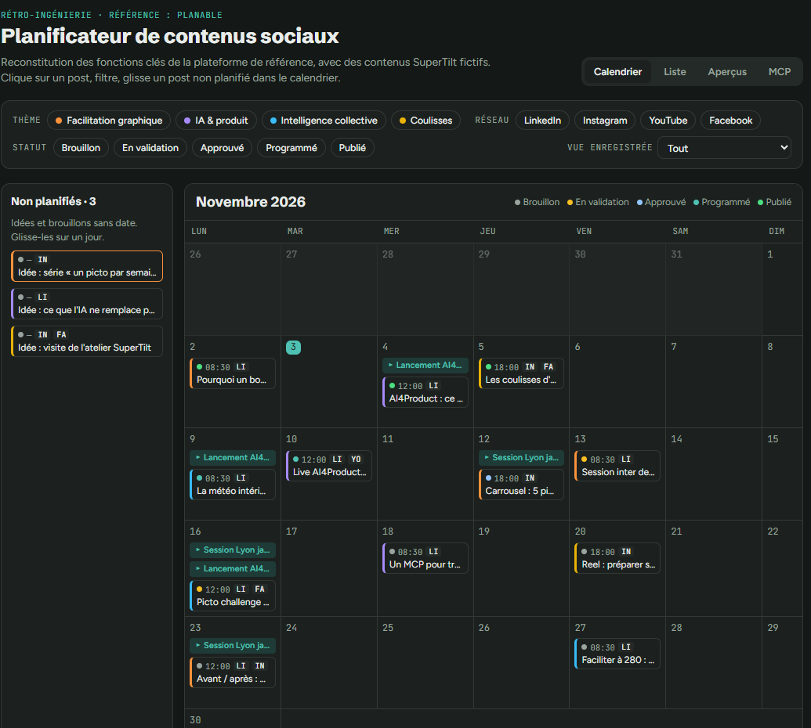

# Maquette du calendrier

Maquette de référence fournie par Romain le 3 novembre 2026, avec des contenus fictifs.

## Ce que la maquette fixe

- **Onglets** : Calendrier, Liste, Aperçus, MCP.
- **Filtres** : thème, réseau et statut, par pastilles. Une liste « Vue enregistrée » rappelle une combinaison de filtres.
- **Colonne « Non planifiés »** : idées et brouillons sans date, avec leur nombre, à glisser sur un jour.
- **Grille mensuelle** du lundi au dimanche, avec le jour courant mis en évidence.
- **Carte de contenu** dans un jour :
  - pastille de statut ;
  - heure ;
  - badges des canaux (LI, IN, FA, YO) ;
  - liseré gauche à la couleur du thème ;
  - début du titre.
- **Campagnes** : un bandeau au-dessus des cartes, sur chaque jour qu'elles couvrent.
- **Légende des statuts** : Brouillon, En validation, Approuvé, Programmé, Publié. C'est l'échelle affichée, calculée à partir des deux axes : voir `statuts-et-validation.md`.
- **Canaux de la maquette** : LinkedIn, Instagram, YouTube, Facebook. Blog et Le Déclic s'y ajoutent.
