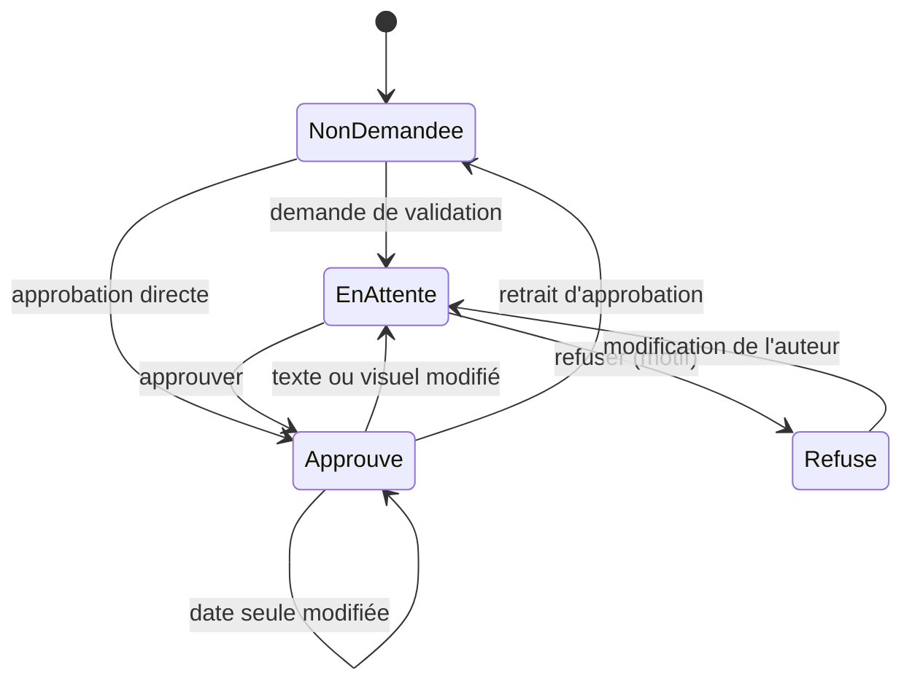

# Statuts et circuit de validation

Deux axes indépendants sur chaque post. L'axe validation porte sur tout le groupe, c'est-à-dire sur toutes les déclinaisons d'un même contenu.

## Axe validation

| Valeur | Sens |
| --- | --- |
| Non demandée | Brouillon, personne n'a été sollicité |
| En attente | Validation demandée, aucune décision |
| Approuvé | Un approbateur a validé |
| Refusé | Un approbateur a refusé, avec un motif obligatoire ; renvoyé à l'auteur |

## Axe publication

| Valeur | Sens |
| --- | --- |
| Sans date | Brouillon, rangé dans la colonne des sans-date |
| Programmé | Date posée, pas encore publié |
| Marqué comme publié | Publié à la main, hors outil |

## Échelle affichée

Elle est calculée à partir des deux axes, et la première condition vraie l'emporte :

| Affiché | Condition |
| --- | --- |
| Publié | Publication : marqué comme publié |
| Programmé | Validation : approuvé, et une date est posée |
| Approuvé | Validation : approuvé, sans date |
| En validation | Validation : en attente |
| Brouillon | Tout le reste, y compris un post refusé, qui affiche alors son motif |

## Règles

| Événement | Effet |
| --- | --- |
| Demande de validation | Validation : en attente ; une action quotidienne est créée pour l'autre approbateur |
| Approbation | Par Romain ou Emmanuelle, auteur compris ; s'applique à tout le groupe ; tracée dans l'historique |
| Retrait d'approbation | Retour à « non demandée », tracé dans l'historique |
| Refus | Motif obligatoire ; validation : refusé ; l'auteur est notifié |
| Modification du texte ou d'un visuel d'un post approuvé | Validation : en attente |
| Modification du texte ou d'un visuel d'un post refusé | Validation : en attente |
| Changement de date seul | L'approbation est conservée |
| Glisser un brouillon sur un jour | Date posée sur tout le groupe ; publication : programmé |
| Marquer comme publié | Publication : marqué comme publié ; l'approbation est conservée ; le post reste modifiable |
| Brouillon créé par le MCP | Validation : non demandée, ou en attente si l'appel la demande |
| Approbation directe d'un brouillon | Permise, sans demande préalable |
| Refus d'un contenu approuvé | Interdit : retirer d'abord l'approbation |
| Nouvelle demande pour un contenu refusé non modifié | Interdite |
| Changement de thème, de format ou de campagne | Sans effet sur la validation |
| Ajout d'un canal à un contenu approuvé | Validation : en attente |
| Date ou texte synchronisé changé sur un contenu partiellement publié | Seules les déclinaisons non publiées changent ; le contenu affiche le statut le moins avancé de ses déclinaisons |

Garde : seule la fonction de transition écrit le statut de validation. Un trigger refuse toute autre écriture, y compris avec la clé service role. La fonction reçoit l'acteur : `auth.uid()` depuis le navigateur, un paramètre acteur accepté seulement en service role (MCP). Les approbateurs sont Romain et Emmanuelle, dans une liste réglable.

Un post groupé est un post par canal, liés. Le texte est commun tant que la synchro est active ; la couper rend chaque déclinaison indépendante.

## Cycle de vie

L'axe publication évolue en parallèle : sans date, puis programmé, puis marqué comme publié.
